<div align="center">

# 🎒 KFKA · Acompanhamento Escolar

**A escola e a família acompanhando o aluno juntas.**

Frontend da **Entrega 2** · Projeto Interdisciplinar · 2º semestre de ADS · **FECAP** 2026 · Grupo COMMIT

[](https://paulomarcelli.github.io/Projetos/Projetos/KFKA/)


<br>

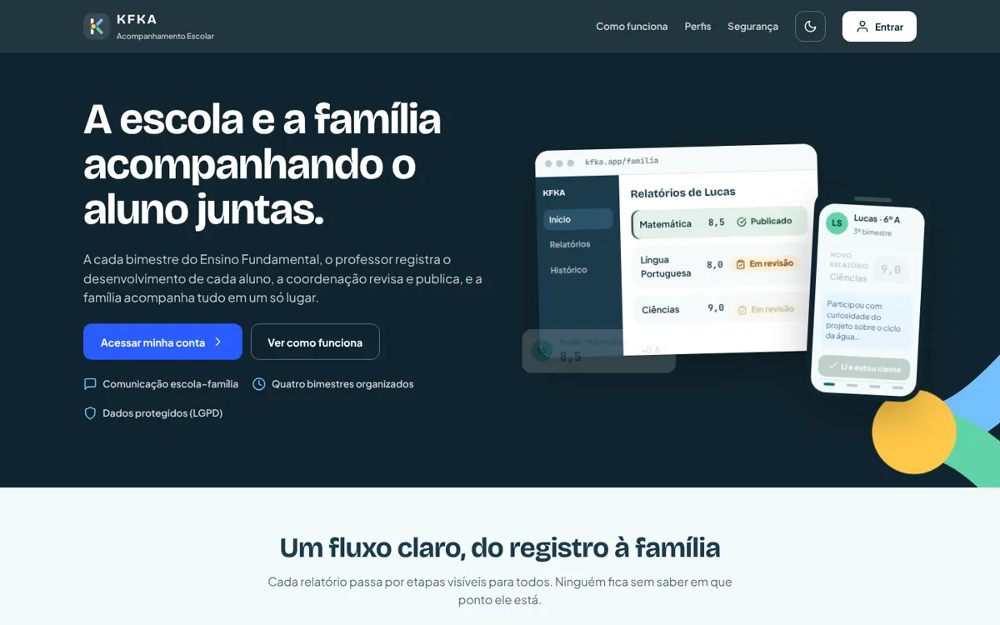

</div>

<br>

> [!NOTE]
> Protótipo **de design**, sem servidor nem banco. O login e o cadastro funcionam dentro do navegador: as contas criadas ficam na memória da página e somem ao recarregar. Os dados da escola são fictícios e as ações nas telas são simuladas (o aviso "SIMULAÇÃO LOCAL" aparece na tela).

## ✨ A ideia

A cada bimestre do Ensino Fundamental, o **professor** registra o desenvolvimento de cada aluno, a **coordenação** revisa e publica, e a **família** acompanha tudo num só lugar, registra que leu e pode responder.

O fluxo é visível para todos: **Rascunho → Enviado → Em revisão → Publicado**, com as saídas *Devolvido* e *Cancelado*. A família só vê o que já foi revisado e publicado, e só dos alunos ligados a ela.

| Cor | | Uso |
|---|---|---|
| Tinta | `#1B3A4B` | Marca e fundos escuros |
| Teal | `#0B7285` | Cor secundária |
| Azul de ação | `#2A5CFF` | Botões principais |
| Sol e menta | `#FFC94A` · `#5FD4A8` | Destaques e celebração |

Fontes: **Bricolage Grotesque** nos títulos, **Plus Jakarta Sans** nos textos e **JetBrains Mono** nas médias. Tem **modo escuro**.

## 👥 Três perfis

<table>
  <tr>
    <td width="50%">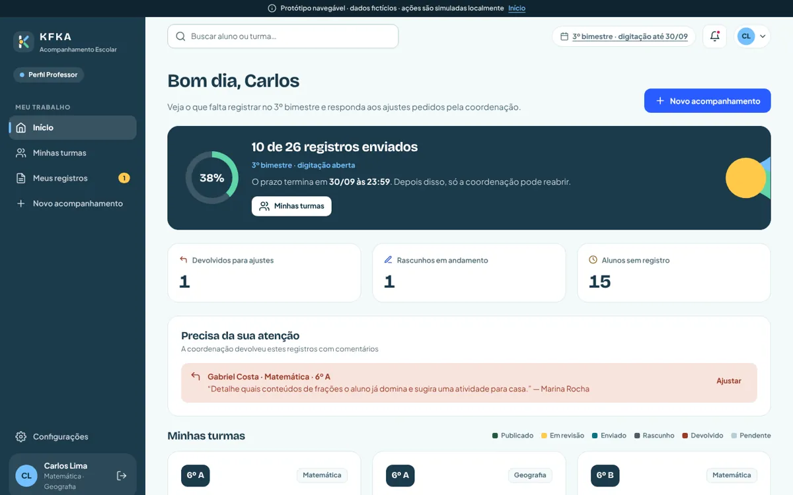</td>
    <td width="50%">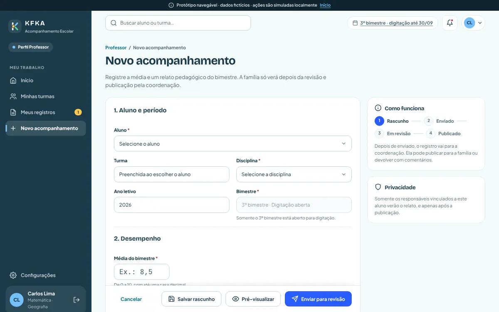</td>
  </tr>
  <tr>
    <td align="center"><sub><b>Professor</b>: o andamento do bimestre e o que a coordenação pediu</sub></td>
    <td align="center"><sub><b>Novo acompanhamento</b>: média e relato pedagógico, com prévia antes de enviar</sub></td>
  </tr>
  <tr>
    <td width="50%">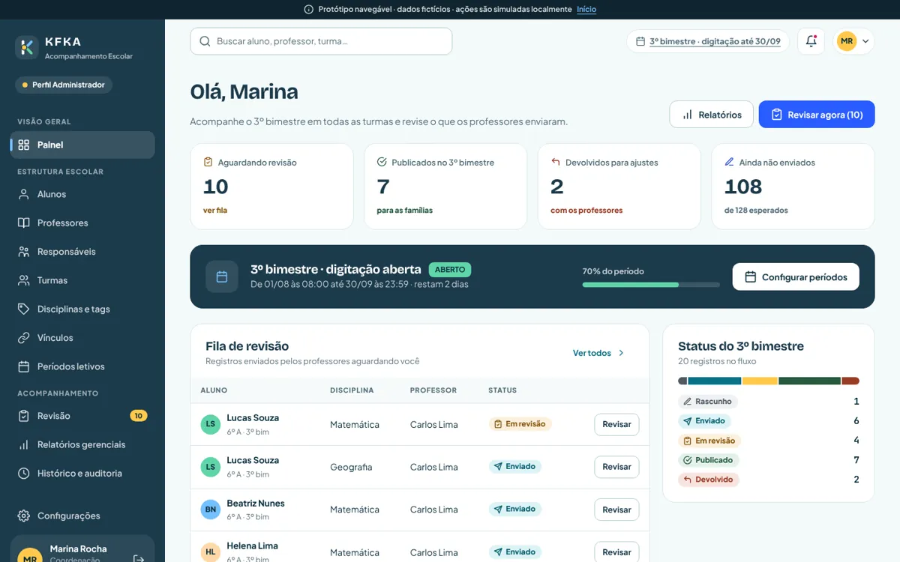</td>
    <td width="50%">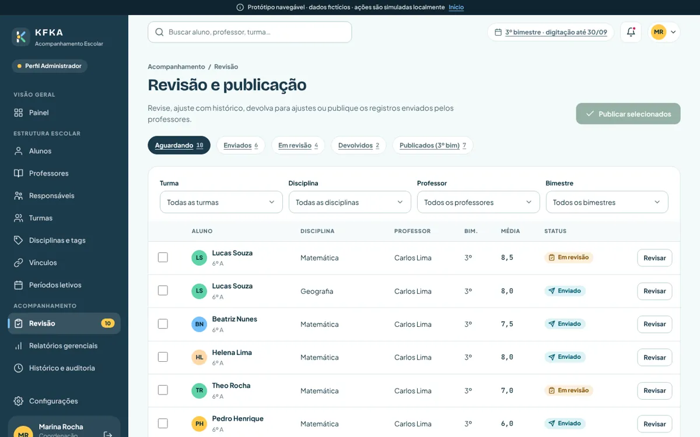</td>
  </tr>
  <tr>
    <td align="center"><sub><b>Coordenação</b>: o bimestre inteiro num painel</sub></td>
    <td align="center"><sub><b>Revisão e publicação</b>: revisar, devolver com comentário ou publicar em lote</sub></td>
  </tr>
  <tr>
    <td width="50%">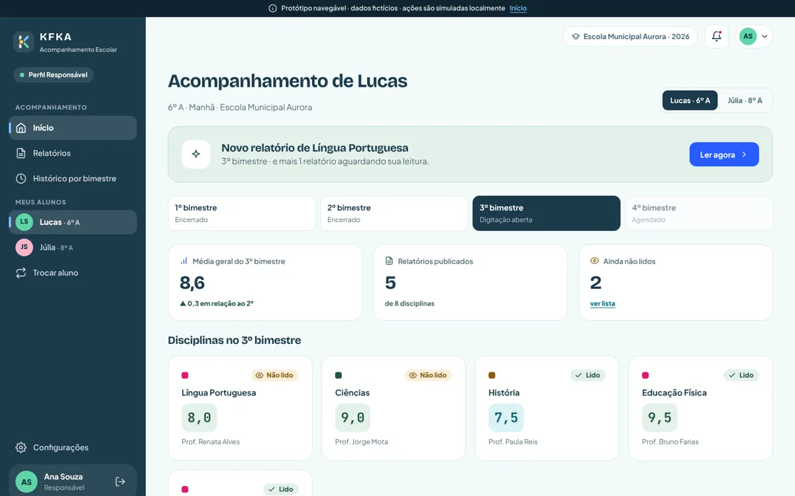</td>
    <td width="50%">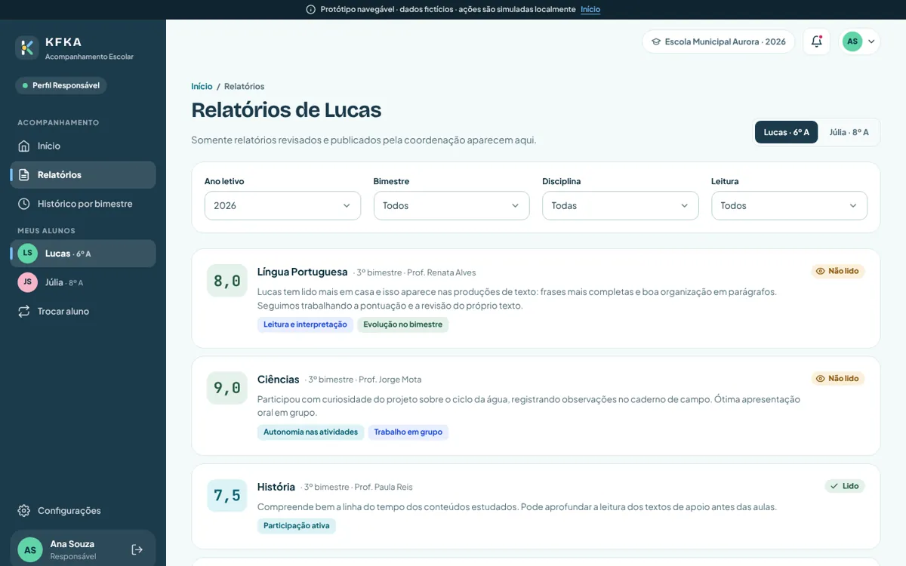</td>
  </tr>
  <tr>
    <td align="center"><sub><b>Família</b>: o bimestre do filho, com o que ainda não foi lido</sub></td>
    <td align="center"><sub><b>Relatórios</b>: só os publicados, com ciência, resposta e PDF</sub></td>
  </tr>
</table>

<p align="center">
  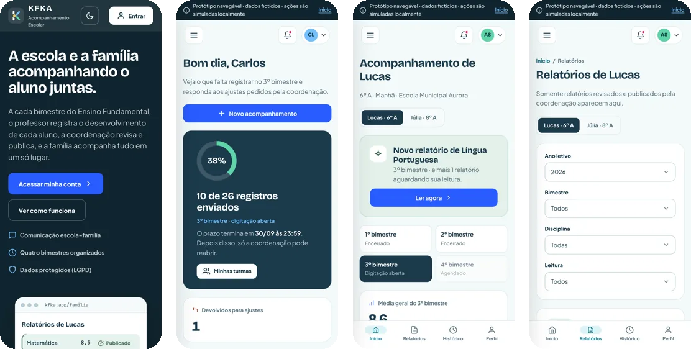<br>
  <sub><b>No celular</b>: barra de abas embaixo, tabelas viram cartões e os modais abrem como folha</sub>
</p>

## 🔑 Entrar e criar conta

Cada perfil entra com a **própria conta**: não existe atalho de demonstração no login.

- **Criar conta** (`#/criar-conta`): a pessoa escolhe o perfil e preenche um formulário de uma coluna.
  - **Coordenação:** nome da escola e cargo.
  - **Professor:** código de convite da escola e disciplina principal.
  - **Responsável:** código de convite do aluno, parentesco e consentimento LGPD.
- **Entrar:** o login confere a conta e explica o problema: e-mail sem conta, conta de outro perfil ou senha errada (com as tentativas restantes e bloqueio na terceira).
- **Só com login:** as áreas da coordenação, do professor e da família só abrem com a conta do perfil certo. Quem abre uma dessas telas sem entrar vai para o login e, depois de entrar, volta para ela.
- **Depois de entrar**, o menu e as saudações mostram quem entrou. A sessão vale para a aba: F5 não desloga, fechar a aba ou "Sair" encerra.
- **Vitrine:** na página inicial, a seção "Três perfis" mostra uma prévia do que cada perfil vê, com o botão **Entrar como …** do perfil.

<table>
  <tr>
    <td width="50%">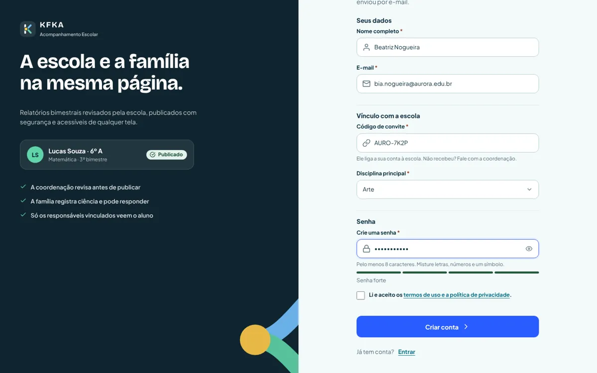</td>
    <td width="50%">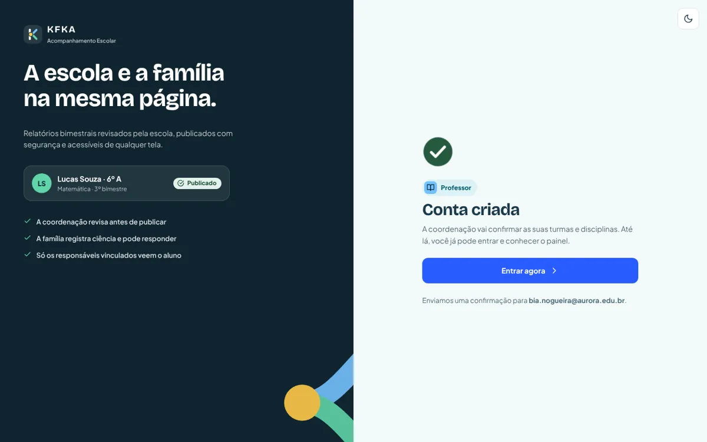</td>
  </tr>
  <tr>
    <td align="center"><sub><b>Criar conta</b>: validação ao sair do campo, mostrar senha e força da senha</sub></td>
    <td align="center"><sub><b>Conta criada</b>: o próximo passo de cada perfil e o atalho para entrar</sub></td>
  </tr>
</table>

**Contas de teste** (pessoas fictícias da Escola Municipal Aurora, senha `kfka2026`):

| Perfil | E-mail |
|---|---|
| Coordenação | `marina.rocha@aurora.edu.br` |
| Professor | `carlos.lima@aurora.edu.br` |
| Responsável | `ana.souza@email.com` |

## 🎨 Documentação de design

O próprio protótipo traz as entregas de Design de Interface Digital:

<table>
  <tr>
    <td width="50%">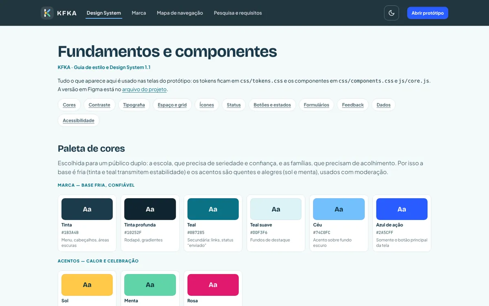</td>
    <td width="50%">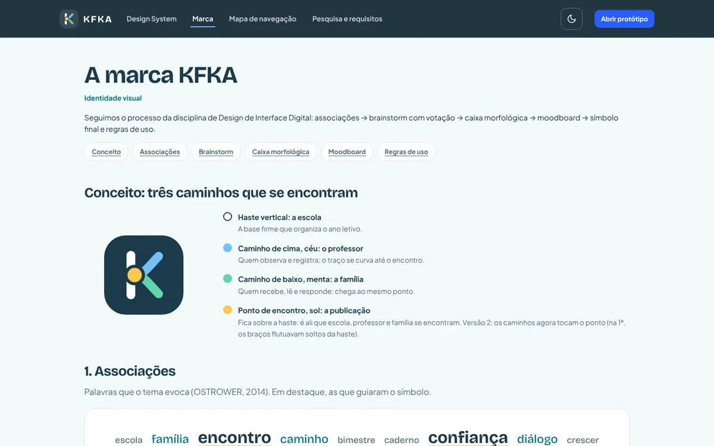</td>
  </tr>
  <tr>
    <td align="center"><sub><b>Design System</b> (<code>#/design</code>): tokens, contraste, componentes e estados</sub></td>
    <td align="center"><sub><b>Marca</b> (<code>#/marca</code>): associações, brainstorm, caixa morfológica e regras de uso</sub></td>
  </tr>
</table>

Também há o **mapa de navegação** clicável (`#/mapa`) e a **pesquisa e matriz de requisitos** (`#/documentacao`).

## ♿ Acessibilidade

Em **Configurações** (nos três perfis), a seção **Acessibilidade** reúne:

- **Tamanho do texto** em quatro níveis (Padrão, Médio, Grande e Muito grande, de 100% a 150%), com botões A−/A+ e uma prévia ao vivo. Aumenta o sistema inteiro: menu, tabelas, formulários e relatórios.
- **Espaçamento de leitura:** mais espaço entre linhas, letras e palavras.
- **Sublinhar links:** links no texto deixam de depender só da cor.
- **Reduzir animações**, além do que o aparelho já pede.

As escolhas valem enquanto a aba estiver aberta (F5 mantém) e podem voltar ao padrão com um clique. O perfil da família tem o mesmo controle de tamanho.

Todo o texto usa `rem`, então o tamanho de letra configurado no navegador ou no celular também é respeitado. Com o texto grande num computador, o menu lateral vira gaveta quando a largura útil fica pequena.

Outros cuidados:

- Responsivo do celular de 320 px ao computador, sem rolagem lateral, inclusive com o texto em 150%: no tablet o menu vira gaveta, no celular as tabelas viram cartões e os modais abrem como folha.
- Navegação pelo teclado, foco visível, alvos de toque de 44 px e contraste AA.
- Status sempre com **texto, ícone e cor**, nunca só cor.
- Respeita **"reduzir movimento"** do sistema.
- Modo pior caso (`index.html?dados=pior`) com nomes e textos extremos, para testar o layout.

## 🛠️ Como rodar

Não tem build: abra o `index.html` direto no navegador. Se preferir um servidor local, rode nesta pasta:

```bash
python3 -m http.server 8000   # ou: npm start
```

Depois é só abrir `http://localhost:8000`.

## 🧪 Testes

Testes automáticos com Playwright: navegação por todas as rotas, fluxos dos três perfis, criar conta e login, acessibilidade (tamanho do texto, telas a 150% e foco no modal) e pior caso.

```bash
npm install             # instala o Playwright e o Prettier (só para os testes e a formatação)
npx playwright install chromium
npm test                # roda todos; falha se algum teste falhar
```

Cada teste também roda sozinho, por exemplo `node tests/flows.js`. Para conferir uma tela no celular: `node tests/overflow.js /familia/painel`.

O código segue o Prettier (`.prettierrc.json`): `npm run format` formata e `npm run format:check` só confere.

## 📁 Estrutura

```text
Frontend/
├── index.html          # carrega os estilos e os scripts na ordem
├── css/
│   ├── tokens.css      # cores, fontes, espaços e raios (modo claro e escuro)
│   ├── base.css        # reset, tipografia, foco e utilitários
│   ├── layout.css      # menu, topo, páginas públicas e telas de conta
│   ├── components.css  # botões, campos, status, tabelas, modais, gráficos…
│   └── pages.css       # estilos de cada página, impressão e documentação
├── js/
│   ├── core.js         # ícones, roteador, avisos, modal, validação e preferências
│   ├── data.js         # dados fictícios e KFKA.api (o único ponto que vai falar com o backend)
│   ├── shell.js        # sessão, guarda das áreas logadas e layout logado
│   └── pages/          # público, coordenação, professor, família, configurações e documentação
├── tests/              # Playwright
└── docs/               # PRD, auditoria de requisitos, pesquisa e as imagens deste README
```

### Como o código se organiza

- **Sem módulos nem build:** cada arquivo é um script clássico que pendura suas funções no objeto global `KFKA`. Por isso a ordem dos `<script>` no `index.html` importa.
- **Cada tela é um objeto** `{ title, render(params, query), mount(root, params, query) }`, registrado com `KFKA.route('/caminho/:id', tela)`. `render` devolve o HTML; `mount` liga os eventos depois que o HTML entra na página.
- **Ações por atributo:** botões com `data-action="nome"` chamam `KFKA.actions.nome`, sem um `addEventListener` para cada botão.
- **Segurança no HTML:** todo texto digitado passa por `KFKA.esc()` antes de ir para o `innerHTML`.
- **Cores só por token** (`var(--teal)`): o modo escuro troca os tokens e o resto acompanha.

## 🔍 Revisão desta entrega

Revisão de design e de código feita antes de subir para este repositório:

- **Acessibilidade:** com um modal aberto, Tab e Shift+Tab não levam mais o foco para a página de trás (há teste em `tests/flows.js`).
- **Tablet:** os filtros dos relatórios gerenciais não cortam mais o texto dos seletores, e o gráfico de tags mostra o nome inteiro ("Participação ativa").
- **Impressão:** as seções da página inicial que aparecem ao rolar agora saem visíveis também no papel.
- **Código:** formatado com Prettier, com comentários em português nas telas, nos componentes compartilhados e nas regras do roteador e da sessão.
- **Testes:** `npm test` roda tudo e falha quando algo quebra; o teste de preferências espera a tela de verdade em vez de um tempo fixo.

O próximo passo previsto é a fase funcional com **Node/Express e MySQL**: só a `KFKA.api` passa a usar `fetch()`.

<div align="center">
<br>

Feito com 💛 pela equipe do Projeto Interdisciplinar · ADS · FECAP

</div>
